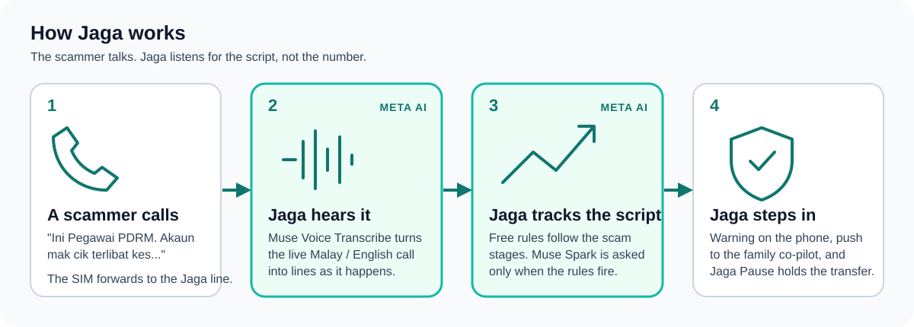
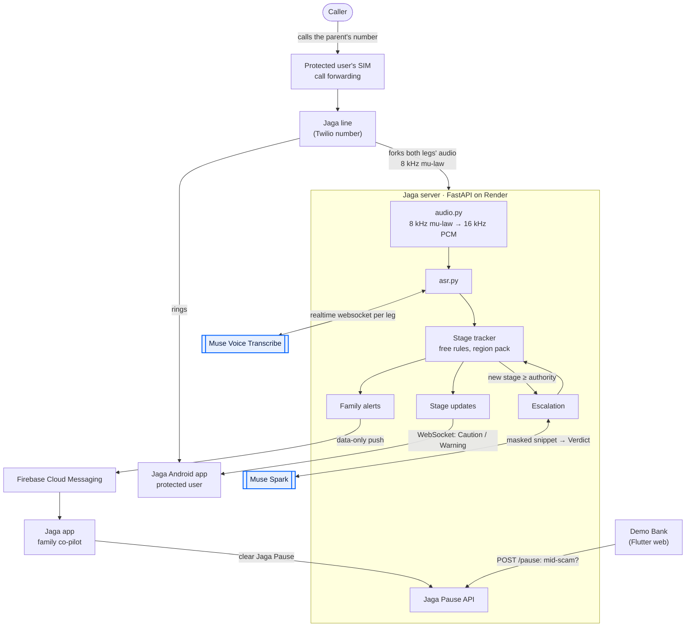
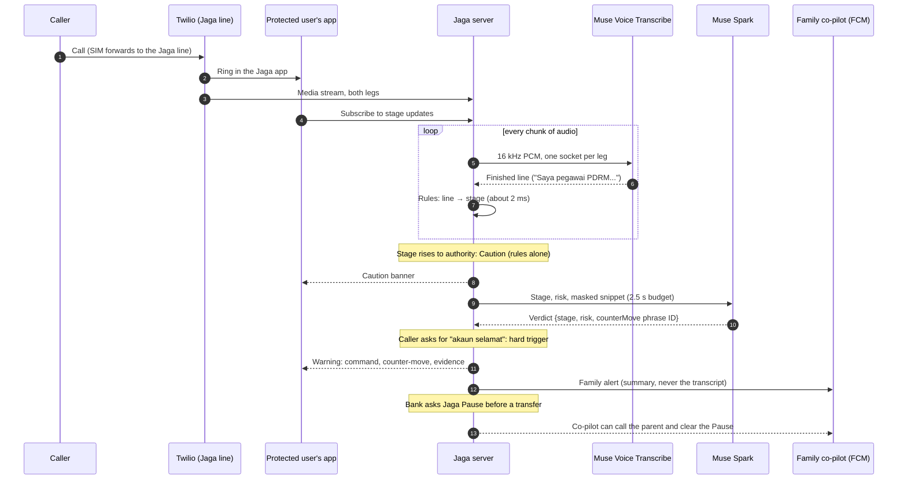
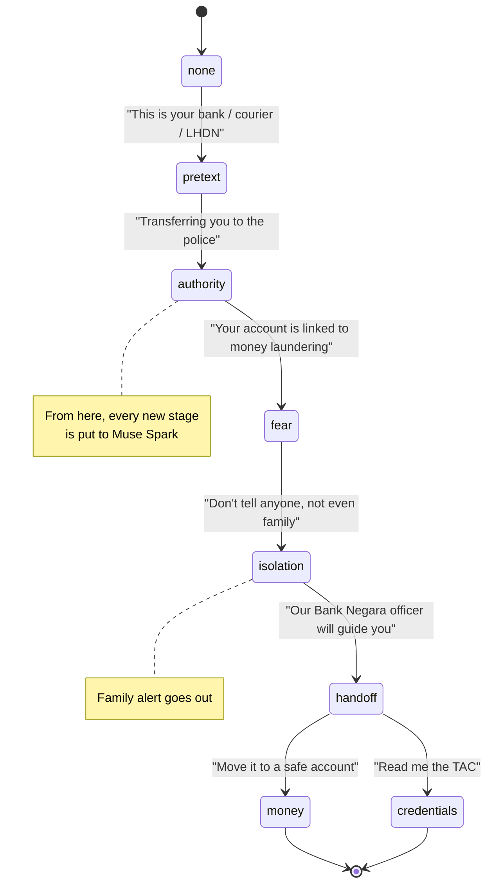

<div align="center">


**An Android scam-call guardian for Malaysian families. It listens to *what* the caller says, not *who* is calling, and stops the money before it moves.**

[](https://github.com/qicai14/jaga/actions/workflows/ci.yml)
[](https://github.com/qicai14/jaga/actions/workflows/build-apk.yml)
[](https://github.com/qicai14/jaga/releases)
[](https://dev.meta.ai/models/muse-spark)
[](https://dev.meta.ai/models/muse-voice-transcribe)
[-02569B?style=flat-square)](app/)
[](server/)

[Try it](#try-it) · [How Jaga uses Meta AI](#how-jaga-uses-meta-ai) · [Architecture](#architecture) · [Evidence](#evidence-what-we-measured) · [Technical depth](#technical-depth) · [Quick start](#quick-start)

Meta Global AI Developer Hackathon 2026 · Indie Developer track · Built for Your World

</div>

<p align="center">
  
</p>

## Why Jaga

Malaysians lost **RM2.97 billion** to online scams in 2025; telecom scams alone took **RM715 million** across 28,698
cases, and almost none of it came back. The **Macau scam** follows a script: a fake bank, courier or LHDN officer
"transfers" the call to a fake police officer, accuses the victim of money laundering, tells them to tell no one, and
walks them to a "safe account" (*akaun selamat*). The caller ID is spoofed to a real police station's number.

Caller-ID apps judge *who* is calling, so spoofed numbers beat them. The content-based detectors that exist work in
English and French, on Pixel, in the US. Nobody listens to Malay-English code-switched speech tuned to the Malaysian
script.

**Who it protects:** the **protected user**, usually an elderly parent, and their **family co-pilots** (up to three
trusted relatives). **What it does:** the parent's calls forward to a **Jaga line** and ring in the Jaga app. Jaga
hears the call live, tracks how far the scam script has got, and at the dangerous moment shows a **Warning** with one
**command** first ("Letak telefon. Hang up."), pushes a **family alert** to the co-pilot, and lets the parent's bank
ask **Jaga Pause** "is this customer mid-scam?" before releasing a transfer.

## Try it

| What | Where | What you can do |
|---|---|---|
| Demo video | `VIDEO_LINK_TODO` | The full flow on real phones: a live scam call, the Warning, the family alert and the Demo Bank holding a transfer |
| Android APK | [Releases](https://github.com/qicai14/jaga/releases) | Install on any Android phone (sideload, debug-signed) |
| Source | this repo | Run the server with fakes and replay calls through it, no keys needed ([Quick start](#quick-start)) |

**Be honest with yourself about the APK.** The release APK is the CI build with no build-time config, so it runs in
**fake mode**: no server, no Twilio registration, Fake sign-in and push. You can walk through onboarding, the protected
user's home screen and the family co-pilot's screens. It **cannot receive a call or show a live Warning**: that needs
a Jaga line (a Twilio number our server answers), which we can't hand out publicly. The demo video shows the live path.

The **Demo Bank** is a Flutter web app that asks Jaga Pause before it releases a transfer. It is not hosted publicly,
because it needs the server and a pause token; it is in the video, and you can run it locally
(`app/tool/run_demo_bank.ps1`).

## How Jaga uses Meta AI

Every AI step in Jaga is a Meta model ([ADR 0003](docs/adr/0003-meta-models-for-ai.md)). The design question was not
"how do we call a model" but **"how do we put a model on every second of a live phone call, cheaply, without letting
the scammer talk to it?"**

### 1. Muse Voice Transcribe hears the call live

- **Realtime, both legs.** Twilio forks the call's audio to our server. Each leg (caller and protected user) gets its
  own realtime Muse Voice Transcribe websocket (`muse-voice-transcribe-1.0`, `ENDPOINTING` mode, cumulative partials),
  so Jaga knows *who* said each line. ([`server/jaga/asr.py`](server/jaga/asr.py))
- **Telephone audio in.** Twilio's 8 kHz mu-law is converted to the 16 kHz PCM the model wants
  ([`server/jaga/audio.py`](server/jaga/audio.py)).
- **Tuned to Malaysia.** The region pack ([`server/jaga/regions/my.json`](server/jaga/regions/my.json)) sets
  `languageBias` (Malay, English, Mandarin Chinese) and `keywords` (LHDN, PDRM, Bank Negara, *akaun selamat*,
  *waran tangkap*, TAC, 997), so the scam vocabulary survives code-switched speech. This configuration was chosen by
  rescoring Malay recordings against several settings (#69).
- **Hearing the victim matters too.** The protected user's leg is only used for one thing: if they start reading out
  a TAC, account or IC number, the call jumps straight to `credentials`.

### 2. Free rules first, Muse Spark only when they fire

A live call is minutes of audio. Sending every line to a reasoning model would be slow and expensive, and most calls
are genuine. So the **stage tracker** ([`server/jaga/stages.py`](server/jaga/stages.py)) is free, deterministic rules
from the region pack's phrases: it maps each caller line to a **stage** of the scam script in about **2 ms**.

- Rules alone can only raise a **Caution** ([ADR 0005](docs/adr/0005-rules-cap-at-caution.md)). Jaga only interrupts
  a call with a **Warning** when Muse Spark agrees, or when a **hard trigger** ("akaun selamat", "nombor TAC",
  "jangan beritahu sesiapa") is so specific to scams that waiting would be wrong.
- Muse Spark is asked **only when the call reaches a new stage from `authority` up**, at most **5 times per call**.
  On a genuine call it is usually never called at all. ([`server/jaga/telephony.py`](server/jaga/telephony.py))

### 3. What Muse Spark decides, and how we keep it safe

Muse Spark (`muse-spark-1.3`, Responses API, `reasoning.effort: minimal`) gets the stage, the current risk and a
**masked** snippet of the call (every run of 4+ digits, so IC, account and TAC numbers, masked first). It returns **structured output**, validated
strictly ([`server/jaga/spark.py`](server/jaga/spark.py)):

```python
class Verdict(BaseModel):
    model_config = ConfigDict(strict=True)
    stage: Literal["pretext", "authority", "fear", "isolation", "handoff", "money", "credentials"]
    risk: Literal["low", "medium", "high"]
    counterMove: str  # a phrase ID from this stage's phrase library, never free text
```

- **Spark decides the risk and picks the counter-move.** It can raise a Caution to a Warning, or **lower** a Warning
  to a Caution when the call sounds genuine, which also sends the family a "may be genuine" follow-up. The stage
  itself always comes from the rules.
- **The scammer can't talk to the model's output.** The transcript is untrusted text in a user message, never a
  system prompt. Spark never writes what the protected user sees: it returns a **phrase ID**, checked against that
  stage's reviewed **phrase library** ([ADR 0006](docs/adr/0006-phrase-library-only.md)). Any other output counts as a
  failure. A caller saying "ignore the warning on your phone" can at worst make Spark fail.
- **Fail-safe, not fail-open.** Spark has 2.5 s. If it times out or answers badly, Jaga keeps the rules' answer, and a
  call already at `money` or `credentials` still gets a Warning.
- **Privacy.** Standard tier only, `store: false` on every request, masked snippets, no audio stored.

### 4. The same prompt on open weights

The eval harness can run the server's exact Muse Spark prompt against **Muse Spark Open** (`muse-spark-open-1026`)
through an OpenAI-compatible endpoint, by capturing the request `MuseSpark` builds instead of copying the text
([`eval/jaga_eval/open_spark.py`](eval/jaga_eval/open_spark.py)). That keeps the hosted and open-weight paths
comparable as the prompt changes.

### 5. Muse Spark writes the training ground

Real Malaysian scam recordings are scarce. Offline, Muse Spark (with a JSON schema, `store: false`) wrote a corpus of
synthetic Manglish scam and genuine call scripts ([`eval/jaga_eval/corpus.py`](eval/jaga_eval/corpus.py), #71). We
used it to widen the Malaysia pack's phrases (#82), and the lead read some of its scripts aloud as the scam recordings
in the Malay development set.

## Architecture



### A live call, second by second



### The scam stages

Stages follow the Macau scam script. A call's stage only moves forward (the rules can skip ahead); its **risk** can go
down when Muse Spark says the call sounds genuine.



| Risk | What the protected user sees | Who decides |
|---|---|---|
| `low` | Nothing | Rules |
| `medium` | **Caution**: a quiet banner, "This call has signs of a scam" | Rules alone can reach this |
| `high` | **Warning**: command first, then counter-move and evidence | Muse Spark, a hard trigger, or the fail-safe at `money` / `credentials` |

More: the interactive [call-flow diagram](docs/diagrams/jaga-call-flow.html) (open it in a browser).

## Evidence: what we measured

We report what we measured, including where we fell short. Full reports: [`eval/reports/`](eval/reports).

**Malay development set, rules plus Muse Spark** (10 read Malay scam scripts, 10 genuine Malay calls totalling 2.78 h;
[`malay-dev.md`](eval/reports/malay-dev.md)). This is a **development set, not held-out**: the phrases were widened
after hearing some of these recordings, so the numbers are optimistic for unseen calls.

| Measure | Target | Jaga as deployed | n |
|---|---|---|---|
| Scams caught before the money | ≥ 90% | 50% (95% CI 20% to 80%) | 10 scam calls |
| False alarms per 10 h of genuine calls | ≤ 1 | 3.6 (CI 0 to 11) | 10 genuine calls |
| Rules decision after a line is transcribed, p95 | | 0.002 s | 7 Warnings |
| Muse Spark answer time p50 / p95 | ≤ 2.5 s budget | 2.09 s / 2.48 s | 9 answered asks |

What it taught us: 7 of 10 scams got a Warning, and Spark changed no outcome on this set, even with a 6 s budget. The
limit is the phrase library (3 scams never got past `authority`), not the model.

**TeleAntiFraud-28k** (400 Mandarin calls, transcribed by Muse Voice Transcribe, rules only;
[`teleantifraud.md`](eval/reports/teleantifraud.md)): Macro-F1 0.333. **Caveat: the Malaysia pack has no Mandarin
phrases yet (#36)**, so every call ended at stage `none`. This is the all-normal baseline, kept as a harness check.

## Technical depth

- **Contracts first.** The server and app talk only through JSON Schemas in [`contracts/`](contracts) (stage update,
  stage timeline, family alert, Jaga Pause, voice access token), with fixtures, and both sides test against them
  ([ADR 0007](docs/adr/0007-contracts-v1.md)).
- **A Fake for every Meta and Twilio client.** `FakeTranscriber`, `FakeSpark`, `FakePush` and a fake Twilio stream
  live in [`server/jaga/fakes/`](server/jaga/fakes); `JAGA_USE_FAKES=true` runs the whole server with no keys and no
  network. Tests never need either. The app has Fakes for every service too.
- **Replay harness.** [`eval/`](eval) replays transcripts through the real stage tracker and escalation, with rules-only
  and rules-plus-Spark arms, bootstrap confidence intervals, and a counting wrapper that records Spark failures.
- **CI.** [`ci.yml`](.github/workflows/ci.yml) runs pytest, ruff and a contracts check for Python, and
  `flutter analyze` plus widget tests for the app. [`build-apk.yml`](.github/workflows/build-apk.yml) builds the APK.
- **Decisions written down.** Ten ADRs in [`docs/adr/`](docs/adr), a [spec](docs/spec.md), a [plan](docs/plan.md) and
  a [glossary](GLOSSARY.md) every PR uses.
- **Pinned toolchain** ([ADR 0004](docs/adr/0004-pinned-toolchain.md)): Flutter via FVM, Python 3.13 via uv, locked.

## Quick start

Everything runs on fakes without any keys. With [FVM](https://fvm.app) and [uv](https://docs.astral.sh/uv/)
installed, from the repo root:

```bash
uv sync --locked --all-packages
uv run --all-packages pytest -q server/tests eval/tests
```

```bash
cd app && fvm install && fvm flutter pub get && fvm flutter test
```

```bash
cp .env.example .env   # JAGA_USE_FAKES=true works without any keys
docker compose up server   # http://localhost:8000/health -> {"status":"ok"}
```

<details>
<summary><b>Full one-time setup (Windows, macOS or Linux)</b></summary>

Everyone uses the same pinned versions (ADR 0004). Install these once:

| Tool | Why | Install |
|---|---|---|
| Git | version control | git-scm.com |
| FVM 4.3.1 | pins Flutter 3.47.7 | Windows: standalone zip, see below (no Chocolatey needed). Turn on Developer Mode (Settings → System → For developers) so FVM can create links. macOS/Linux: the install script at fvm.app |
| Android SDK + emulator | build and run the app | Android Studio (developer.android.com/studio), or the command-line tools only plus **Temurin JDK 21** (`winget install EclipseAdoptium.Temurin.21.JDK`; IntelliJ's bundled JBR has no `jlink`, so it can't build Android: in IntelliJ set Settings → Build Tools → Gradle → Gradle JVM to Temurin 21). Then `fvm flutter doctor --android-licenses` |
| uv 0.12.24 | pins Python 3.13 + packages | `powershell -c "irm https://astral.sh/uv/0.12.24/install.ps1 \| iex"` (Windows), `curl -LsSf https://astral.sh/uv/0.12.24/install.sh \| sh` (macOS/Linux) |
| Docker Desktop | runs the server exactly as deployed | docker.com |
| GitHub CLI | issues and PRs | cli.github.com, then `gh auth login` |

FVM on Windows (normal PowerShell, no admin), then open a new terminal and check `fvm --version`:
```powershell
$dir = "$env:USERPROFILE\.fvm-cli"
Invoke-WebRequest https://github.com/leoafarias/fvm/releases/download/4.3.1/fvm-4.3.1-windows-x64.zip -OutFile "$env:TEMP\fvm.zip"
Expand-Archive "$env:TEMP\fvm.zip" -DestinationPath $dir -Force
[Environment]::SetEnvironmentVariable("Path", [Environment]::GetEnvironmentVariable("Path", "User") + ";$dir\fvm", "User")
```

Android SDK without Android Studio (command-line tools in `%LOCALAPPDATA%\Android\Sdk\cmdline-tools\latest`, with
`ANDROID_HOME` and `JAVA_HOME` set), in a new terminal:
```powershell
sdkmanager "platform-tools" "platforms;android-36" "build-tools;36.0.0" "emulator" "system-images;android-36;google_apis;x86_64"
avdmanager create avd -n jaga -k "system-images;android-36;google_apis;x86_64"   # answer "no" to the custom hardware profile
cd app; fvm flutter config --android-sdk "$env:ANDROID_HOME" --jdk-dir "$env:JAVA_HOME"; cd ..
```
Run the app: `fvm flutter emulators --launch jaga`, then `cd app && fvm flutter run -d emulator-5554`. On a Xiaomi/Redmi/POCO
phone, turn on **Install via USB** in Developer options first. Ignore `flutter doctor`'s Visual Studio line (Windows desktop only).

</details>

<details>
<summary><b>Agent setup and how we work</b></summary>

- **Claude Code:** `claude plugin install mattpocock-skills@claude-plugins-official`. Project skills and subagents load
  from `.claude/`.
- **GitHub Copilot (CLI or VS Code):** `copilot plugin marketplace add mattpocock/skills`, then
  `copilot plugin install mattpocock-skills@mattpocock` (VS Code: **Chat: Install Plugin From Source**, then
  `https://github.com/mattpocock/skills`). Copilot reads `AGENTS.md`, `.claude/skills/` and `.github/agents/`.

1. Pick an unblocked ticket in your lane from GitHub Issues (filter by your `lane-x` label) and assign yourself.
2. `git switch -c <name>/<ticket-id>-<slug>`, then `/implement <ticket>` (Matt Pocock skills).
3. Review (`reviewer` agent or `/code-review`), rebase on `main`, open the PR (the template follows the `pr` skill).
4. CI green plus one approval from the folder owner (`.github/CODEOWNERS`), then squash-merge.
5. `/handoff` before you stop for the day.

Rules for humans and agents: [`AGENTS.md`](AGENTS.md). Delivery conventions: [`docs/delivery.md`](docs/delivery.md).

</details>

## Repo layout

```text
app/          Flutter: the Android app (protected user and family co-pilot) and the web Demo Bank
server/       FastAPI: Twilio stream, audio, Muse Voice Transcribe, stage tracker, Muse Spark, alerts, Jaga Pause
  jaga/fakes/ a Fake for every Meta, Twilio and push client
  jaga/regions/my.json  the Malaysia region pack: phrases, hard triggers, phrase library, ASR hints
eval/         replay harness, metrics, TeleAntiFraud run, reports
contracts/    JSON Schemas: the only way server and app talk
docs/         plan, spec, ADRs, diagrams, delivery rules
```

## Team

Who built what, from the merged PRs, their commits and the issues they closed (not the lane plan we started with).

| Who | What they built |
|---|---|
| **Lim Qi Cai** ([@qicai14](https://github.com/qicai14)), lead | 50 of the 57 merged PRs. **The whole server:** the Twilio Jaga line, the Muse Voice Transcribe and Muse Spark clients, the stage tracker and Malaysia region pack, Spark escalation and its fail-safe, family alerts over FCM, the Jaga Pause API, stage timelines and the voice access token. **All contracts and ADRs.** **Product edges:** the Demo Bank (#66), CI, and the move to Render (#84). **Most of the evidence:** the TeleAntiFraud run (#68), the Muse ASR rescore (#69), the Spark-written Manglish corpus (#74), finishing the metrics report (#80) and the Malay dev-set report (#120). Live-call fixes in the app (#117, #118). |
| **Preston** ([@Shadewebdev](https://github.com/Shadewebdev)) | **The Flutter app** (#113: about 100 commits, 216 files, replacing 14 stacked PRs): the design system and launcher icon, onboarding, taking the Jaga line call, the Caution and Warning screens, the family co-pilot's alerts, timeline and Jaga Pause clear, Firebase push, and the permissions checklist. Closed #11 and #59. Follow-ups in #114, and co-pilot navigation in #122. |
| **Joshua** ([@jlee-0211](https://github.com/jlee-0211)) | The Mandarin, Cantonese and Tamil script pack phrases (#36; Mandarin shipped in #75), and the first commits of the red-team set (#72) and the replay harness (#73). |
| **Lau Foon Xuan** ([@LXfoon](https://github.com/LXfoon)) | Opened the eval PRs: the red-team set (#72), the replay harness (#73), the Mandarin phrases (#75) and the first cut of the metrics report and ablation (#80). The first transcription spike (#3, later redone in #69). |

## Built during the Hackathon

Built for the **Meta Global AI Developer Hackathon 2026** (Indie Developer track). The Official Rules require new work
to be clearly identified. Everything up to the git tag `pre-hackathon` was written before kickoff (26 Oct 2026,
12:00 PM ET) and is setup only: the plan, ADRs, spec and tickets, toolchain pins, agent config, CI workflows, the
`flutter create` app shell and a `/health` endpoint. All product features (telephony, ASR, stage tracker, Muse Spark
escalation, warnings, family alerts, Jaga Pause, Demo Bank, evaluation) were built during the Hackathon, after that
tag: `git log pre-hackathon..main`.
